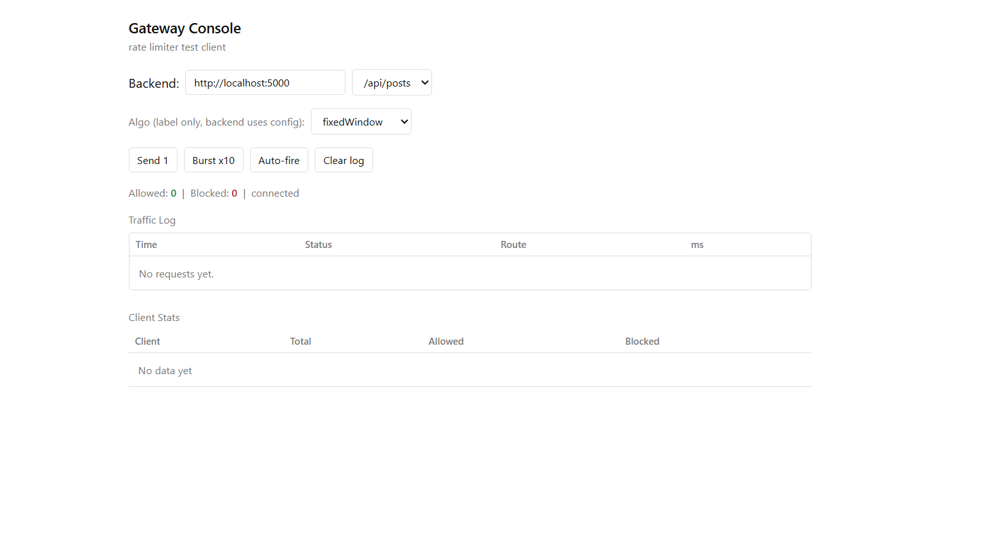
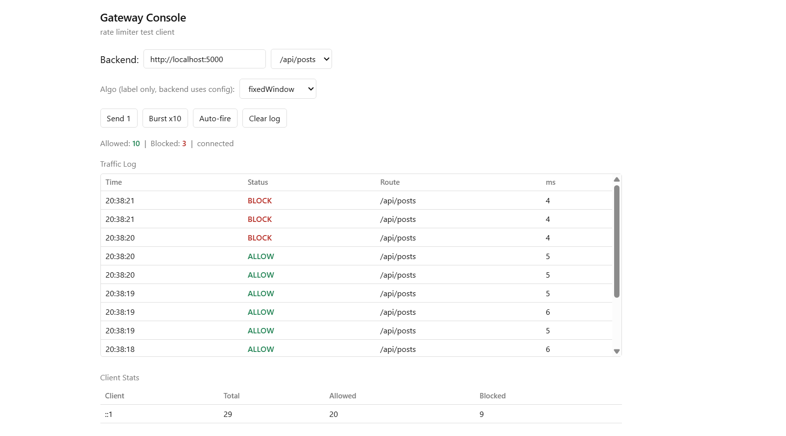
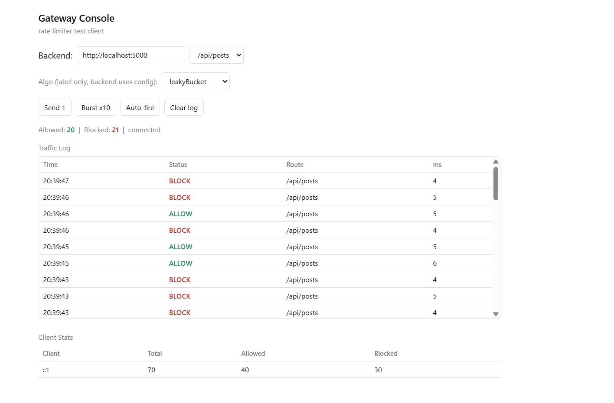

# Rate Limiter Gateway

A lightweight **API Gateway** built with Express that sits in front of the backend services and enforces **rate limiting** using Redis. It supports five different rate limiting algorithms, request logging, and per client stats tracking with a minimal web console to monitor traffic in real time.

---

## Features

-  **5 Rate Limiting Algorithms** — choose per request via query param
  - Fixed Window Counter
  - Sliding Window Log
  - Sliding Window Counter
  - Token Bucket
  - Leaky Bucket
  
-  **Reverse Proxy** — forwards `/api/*` requests to the backend service
-  **Stats Tracking** — tracks total/allowed/blocked requests per client (by IP)
-  **Request Logging** — structured logging via Winston (console + file logs, separate log for blocked requests)
-  **Gateway Console UI** — simple HTML dashboard to test and visualize rate limiting behavior
-  **Redis-backed** — all algorithms use atomic Redis Lua scripts for consistency under concurrent load

---

## Tech Stack

- **Node.js** + **Express 5**
- **Redis** (via `ioredis`) — for distributed rate limit state
- **http-proxy-middleware** — reverse proxy to backend
- **Winston** — logging
- **CORS**

---

## Project Structure

```
rate-limiter-gateway/
├── server.js                  # Main gateway server (port 8080)
├── mockServer.js               # Sample backend service (port 3001)
├── UI/
│   └── index.html              # Gateway Console frontend
├── src/
│   ├── algorithms/
│   │   ├── fixedWindowCounter.js
│   │   ├── slidingWindowLog.js
│   │   ├── slidingWindowCounter.js
│   │   ├── tokenBucket.js
│   │   └── leakyBucket.js
│   ├── config/
│   │   ├── rateLimitConfig.js  # Algorithm & limit configuration
│   │   └── redisClient.js      # Redis connection
│   └── middleware/
│       ├── rateLimiter.js      # Applies the selected algorithm
│       ├── requestLogger.js    # Logs every request
│       ├── statsTracker.js     # Tracks per-client stats
│       └── logger.js           # Winston logger setup
```

---

## Getting Started

### Prerequisites

- Node.js (v18+ recommended)
- Redis server running locally (`redis-server`)

### Installation

```bash
git clone https://github.com/Mohd-Abd-Khan/rate-limiter-gateway.git
cd rate-limiter-gateway
npm install
```

### Running the project

You need Redis running, then start the mock backend and the gateway:

```bash
# Terminal 1 - start Redis (if not already running)
redis-server

# Terminal 2 - start the gateway (auto-starts mock backend if UPSTREAM_TARGET not set)
$env:PORT = "8080"
$env:MOCK_PORT = "3001"
npm start
# Gateway runs on http://localhost:8080
# Mock backend runs on http://localhost:3001
```

Now all requests to `http://localhost:8080/api/*` will pass through the rate limiter before being proxied to the backend.

### Running Tests

The project includes an automated test suite verifying all 5 algorithms, route isolation, concurrency, RFC headers, and reverse proxying:

```bash
npm test
```

---

## Usage

### Making a request through the gateway

```bash
curl "http://localhost:8080/api/users?algo=fixedWindow"
curl "http://localhost:8080/api/posts?algo=tokenBucket"
```

The `algo` query parameter selects which rate limiting strategy to apply:

| Value             | Algorithm               |
|-------------------|--------------------------|
| `fixedWindow`     | Fixed Window Counter     |
| `slidingLog`      | Sliding Window Log       |
| `slidingCounter`  | Sliding Window Counter   |
| `tokenBucket`     | Token Bucket             |
| `leakyBucket`     | Leaky Bucket             |

If no `algo` param is passed, the gateway applies route-based mapping from `ROUTE_ALGO_MAP` or defaults to `tokenBucket`.

### Health check

```bash
GET http://localhost:8080/health
```

Returns service status and live dependency health:

```json
{
  "status": "ok",
  "uptime": 12,
  "timestamp": "2026-10-28T...",
  "dependencies": {
    "redis": "healthy",
    "upstream": "http://127.0.0.1:3001"
  }
}
```

### View stats

```bash
GET http://localhost:8080/stats
```

Returns per-client request counts:

```json
{
  "127.0.0.1": { "total": 12, "allowed": 9, "blocked": 3 }
}
```

---

## Configuration

Rate limit values can be adjusted in `src/config/rateLimitConfig.js`:

```js
export const limit = 10          // requests allowed per window
export const capacity = 5        // bucket capacity (token/leaky bucket)
export const windowSize = 10     // window size in seconds
export const refillRate = 1      // tokens added per second
```

---

## Gateway Console (Frontend)

A simple UI (`UI/index.html`) is included to test the gateway and visualize allowed vs blocked requests in real time. Just open the file in your browser once the gateway is running.

**Screenshots:**




---

## Logging

Logs are written using Winston to:
- `logs/requests.log` — all requests
- `logs/blocked.log` — only rate-limited (429) requests

---

## Author & Attribution

- **Author & Maintainer:** Mohd Abdullah Khan ([@Mohd-Abd-Khan](https://github.com/Mohd-Abd-Khan))
- **Project Background:** Originally developed as a Redis-backed rate-limiting reverse proxy, subsequently audited, refactored, and upgraded with high-concurrency collision fixes, RFC-standard rate-limit headers, leaky bucket overflow correction, automated unit/integration test suites, and security hardening.

